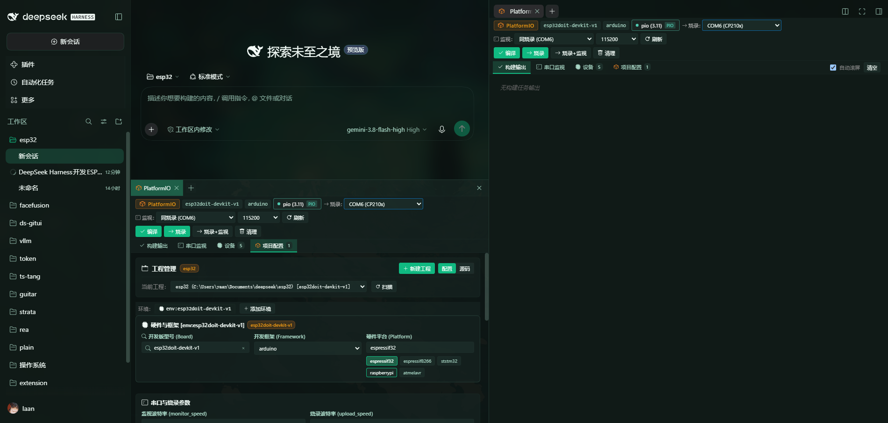

# ds-platformio

PlatformIO IDE plugin for **DeepSeek Harness** (Desktop & Web).  
深度集成于 DeepSeek Harness 原生下边栏与侧边栏中，全功能复刻 VSCode PlatformIO IDE 的嵌入式开发体验。支持 ESP32、ESP8266、STM32、Raspberry Pi Pico、AVR 等全系列微控制器的**编译、烧录、调试、运行、串口监视、环境管理与项目配置可视化**。

---

## 📸 界面预览 (Preview)



---

## ✨ 核心特性 (Features)

### 1. 深度集成 DeepSeek Harness 原生面板
- **原生下侧边栏面板 (Bottom Panel)**：在 DSH 底栏原生多标签工作台注册 `PlatformIO` 标签页，支持面板折叠、高度拖拽与分栏。
- **右侧边栏无缝呼出 (Right Sidebar)**：同步注册至右侧边栏 Tab 与引导卡片，随时一键展开或收起。
- **工作区会话自动感知**：自动绑定当前会话的 `cwd`，智能识别当前目录及子目录下的 PlatformIO 工程。

### 2. 完整嵌入式构建与烧录流水线
- **一键快捷工具栏**：
  - **编译 (Build)**：执行 `pio run`，实时彩色终端流式输出编译过程。
  - **烧录 (Upload)**：执行 `pio run -t upload`，精准锁定烧录串口并自动下载固件。
  - **烧录 + 监视 (Upload & Monitor)**：烧录前自动暂停串口监视释放 COM 占用，烧录完成后秒级自动恢复串口连接。
  - **清理 (Clean)**：清理构建缓存与中间目标文件。
  - **编译数据库 (compiledb)**：一键生成 `compile_commands.json`，为 LSP / clangd 提供完整代码补全支持。
  - **固件占用分析 (Size)**：精准统计 RAM 与 Flash 占用字节数与百分比。

### 3. 双串口独立管理与硬件热拔插实时感知
- **烧录口与监视口解耦**：许多嵌入式场景下调试口与固件下载口分离，支持单独选择烧录端口与监视端口（亦可设置「同烧录」跟随）。
- **设备热拔插毫秒级感知**：后台实时监听系统串口热拔插，插入或移除开发板时界面自动刷新并锁定 USB 串口，告别手动反复刷新。
- **智能过滤**：自动区分 USB 转串口（CP210x、CH340、FTDI 等）、板载调试器与蓝牙/虚拟串口，优先推荐硬件下载端口。

### 4. 双通道高可靠串口监视器 (Serial Monitor)
- **零丢失流式输出**：服务端独立 Python Worker 进程与 SSE 实时管道，支持缓冲区换行聚合与毫秒级即时刷屏。
- **双端自适应**：在 DSH Desktop (Electron `dsh-app://`) 与 Web 浏览器端均保证稳定不中断输出。
- **交互控制**：支持自定义波特率（115200、9600、921600 等）、换行符（CRLF、LF、CR、无）、十六进制/文本数据发送、清屏与自动滚屏切换。

### 5. VSCode 风格 Python 解释器扫描与隔离 (Python Environment)
- **多环境自动探测**：自动枚举系统中的 Conda 环境、项目本地虚拟环境 (`.venv`)、PlatformIO 独立 penv 及全局 Python。
- **依赖自检与一键安装**：秒级检测各环境中的 Python 版本、PlatformIO Core 版本及 pyserial，支持界面内一键为指定环境安装 PlatformIO。
- **环境随心切换**：无需污染全局环境变量，所有 pio 指令与串口 Worker 均严格由所选 Python 解释器执行。

### 6. 项目配置可视化与实时搜索推荐 (Visual Config)
- **开箱即用的可视化表单**：直观配置 `board`、`framework`、`platform`、波特率、过滤器、编译宏 (`build_flags`) 与库依赖 (`lib_deps`)。
- **开发板实时搜索与规格提示**：内置海量开发板索引，输入型号（如 `esp32`、`s3`、`nodemcu` 等）实时推荐并展示 CPU 主频、Flash 与 RAM 规格。
- **库依赖实时检索推荐**：集成热门开源库快速添加推荐与 PlatformIO 库搜索，一键加入项目并自动同步至 `platformio.ini`。
- **原始 INI 与可视化双模无缝同步**：支持随时切换纯文本编辑模式与可视化模式，保存时安全保留注释与格式。

### 7. 新建工程向导与多工程极速切换 (Project Wizard)
- **多工程管理**：自动扫描工作区内所有 PlatformIO 工程，顶部下拉列表一秒切换当前活跃工程与对应环境 (`[env:xxx]`)。
- **向导式新建**：无需记忆命令行参数，输入工程名、搜索选择开发板、选定框架（Arduino / ESP-IDF）与路径即可瞬间生成规范工程脚手架。

### 8. 纯净设计与 DSH 原生主题深度自适应
- **零 Emoji 干扰**：符合专业工程工具的高密度、清晰视觉语言，全套采用轻量矢量 SVG 图标。
- **自适应 DSH 主题**：完整继承 DeepSeek Harness CSS 设计系统变量（`--dsw-alias-*`），深色/浅色模式无缝自适应。

---

## 🚀 安装方法 (Installation)

### 方式 1：通过 DeepSeek Harness 扩展界面安装（推荐）

1. 打开 DeepSeek Harness 左侧导航栏中的 **插件**（或全局面板）。
2. 点击 **添加插件** -> **安装第三方插件**。
3. 在输入框中填入 GitHub 仓库地址：
   ```text
   github:yaanlaan/ds-platformio
   ```
   或
   ```text
   https://github.com/yaanlaan/ds-platformio
   ```
4. 点击 **安装**，安装完成后即可在下侧面板看到 **PlatformIO** 标签页。

---

### 方式 2：本地软链接开发安装 (Local Development)

如果你希望在本地二次开发或定制插件：

1. 克隆代码至本地目录：
   ```bash
   git clone https://github.com/yaanlaan/ds-platformio.git C:/Users/<YourUser>/Documents/deepseek/ds-platformio
   ```

2. 在你的 DSH Profile 目录（如 `~/.dsh/profiles/desktop`）创建软链接：
   ```powershell
   # Windows PowerShell (管理员或开启开发者模式):
   New-Item -ItemType Junction -Target "C:\Users\<YourUser>\Documents\deepseek\ds-platformio" -Path "C:\Users\<YourUser>\.dsh\profiles\desktop\node_modules\ds-platformio"
   ```

3. 将 `ds-platformio` 登记至 `~/.dsh/profiles/desktop/package.json`：
   ```json
   {
     "dependencies": {
       "ds-platformio": "link:C:/Users/<YourUser>/Documents/deepseek/ds-platformio"
     },
     "dsh": {
       "profile": {
         "bundles": [
           "ds-platformio"
         ]
       }
     }
   }
   ```

4. 重启 DeepSeek Harness 即可生效。

---

## 🛠️ 构建与开发 (Build)

修改 `src/` 下的前端界面或样式后，执行以下命令即可打包出最终的 `lib/client.js`：

```bash
node build.mjs
```

---

## 📄 开源许可证 (License)

[MIT License](LICENSE) © 2026 [Yaan](https://github.com/yaanlaan)
